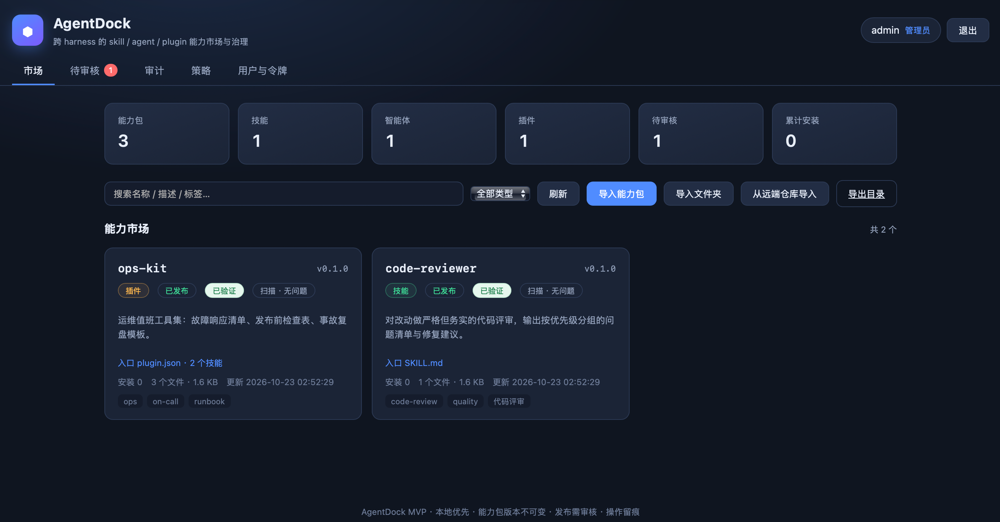
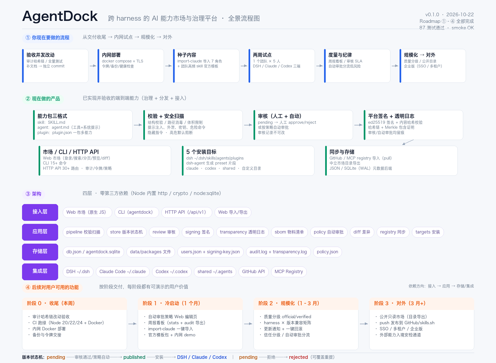
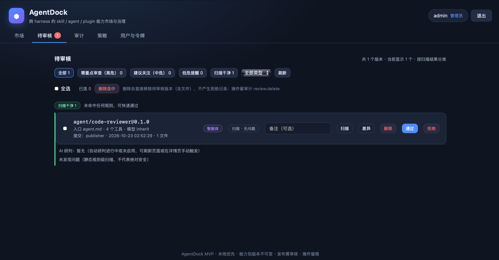
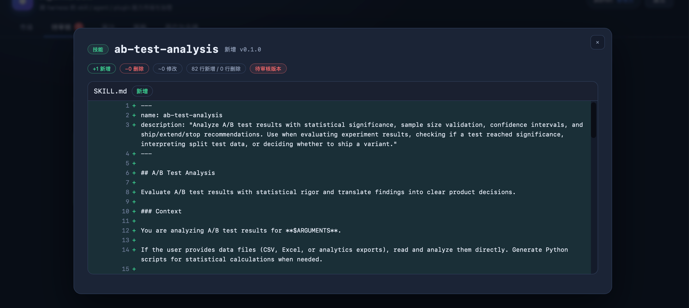

English | [中文](README.zh-CN.md)

[](https://github.com/creativity1013/agentdock-registry/actions/workflows/ci.yml)
[](LICENSE)

# AgentDock

**A self-hosted marketplace for AI coding capabilities** — centrally manage skills, agents, and plugins for Claude Code, Codex, and DSH, with review, security scanning, signing, and auditing built in. One command installs a capability back onto a developer's machine; nothing leaves your network.

`self-hosted` · `skill registry` · `Claude Code` · `Codex` · `governance`

<!-- TODO: screenshot --> 

## How it fits together



<!-- TODO: screenshot --> 

<!-- TODO: screenshot --> 

## 30-second tour

Requires a running server (see below) and the CLI. Token comes from `data/BOOTSTRAP-TOKENS.txt` on first start.

```bash
agentdock login --url http://127.0.0.1:7788 --token <publisher-token>

# Publish
agentdock publish examples/skill-code-reviewer --version 0.1.0

# Review
agentdock review queue
agentdock review approve skill/code-reviewer@0.1.0 --note "LGTM"

# Install
agentdock install skill/code-reviewer --target claude

# Verify signature and content hash
agentdock verify-signature skill/code-reviewer@0.1.0
```

## Up and running in 3 minutes (Docker)

```bash
git clone https://github.com/creativity1013/agentdock-registry
cd agentdock
docker compose up -d --build
docker exec agentdock cat /data/BOOTSTRAP-TOKENS.txt   # admin / reviewer / publisher tokens, created on first start
```

Open `http://localhost:7788` for the marketplace UI. The container listens on `0.0.0.0:7788`, persists everything in the `agentdock-data` volume mounted at `/data`, and ships with a health check against `/api/v1/health`. Prefer bare Node? See [Quick start (Node.js)](#quick-start-nodejs).

## Why not a shared drive?

Teams using Claude Code or Codex usually share skills through chat threads, group files, or a network drive. That works until it doesn't:

| | Shared drive / chat files | AgentDock |
| --- | --- | --- |
| Versioning | Filename conventions, no history | Immutable semver versions, content hash per version |
| Review | None — anyone can overwrite anything | Review queue with line-level diff against the previous published version |
| Security scanning | Manual, if at all | 47 static rules + supply-chain checks on publish; high-severity findings block by default |
| Signing | None | ed25519 platform signature on approval + optional publisher signature |
| Audit trail | None | Append-only JSONL log with a tamper-evident hash chain |
| Install | Copy files by hand | One command to any target (`dsh` / `claude` / `codex` / `shared` / `dir`) |
| Rollback | Find the old zip | `rollback` from the local install manifest (last 5 versions kept) |

## Security model in brief

- **47 static scan rules** across ten groups: prompt injection, data exfiltration, credential leakage, dangerous shell commands, dynamic execution, persistence/harness tampering, hidden instructions (zero-width chars, Trojan Source, homoglyphs), env-key exfiltration, structural checks (description poisoning, npm lifecycle scripts, shell+network tool combos), and binary markers. High-severity findings block publishing (`AGENTDOCK_SCAN_BLOCK` adjusts the threshold). Supply-chain checks flag typosquatted names and diff-scan incremental updates against the last published version.
- **ed25519 dual signing**: the platform signs every approved version (`agentdock-v1` payload, public key at `GET /api/v1/keys`, verifiable offline); publishers can additionally sign with their own key (`publish --key`, TOFU registration). Verification also recomputes the on-disk content hash, so post-publish tampering is detectable.
- **Verifiable transparency log**: every approval appends to a hash-chain log built into an RFC 6962-style Merkle tree. Anyone can verify the whole chain or fetch a per-version inclusion proof (`transparency verify` / `transparency proof`).
- **Audit hash chain with rotation**: append-only JSONL, each record chained via `sha256(seq, prevHash, …)`, `audit verify` pinpoints breaks, rotates at 8 MB keeping 24 archives.
- **Optional LLM advisory review** (off by default): pending versions with any static findings get a second, semantic pass from an OpenAI-compatible model. Results are advisory only — stored and shown to reviewers, never used for blocking decisions. Clean versions consume no model calls.
- **Four token roles + SSO**: `admin` / `reviewer` / `publisher` / `viewer` tokens (stored as sha256 hashes), plus OIDC login (Authorization Code + PKCE) with group-to-role mapping, optional MFA enforcement, per-tenant isolation, and rate limiting.

Scanning is heuristics plus structural checks — not a sandbox. Human review remains part of the loop by design.

## Enterprise / Support

<!-- TODO: confirm the actual offering, pricing model, and contact address before publishing -->
For teams that want help running AgentDock in production, we offer:

- **Deployment & implementation** — assisted setup, SSO/IdP integration, reverse-proxy and TLS configuration
- **Annual maintenance** — priority fixes, upgrade guidance, security-patch backports
- **Team training** — publishing/review workflows for admins, CLI onboarding for developers

Contact: **enterprise@example.com** <!-- TODO: replace with the real contact email -->

## Documentation

- [Architecture](docs/ARCHITECTURE.md) — layers, request lifecycle, data model, design trade-offs
- [Product flow](docs/PRODUCT-FLOW.md)
- [Onboarding a new team](docs/ONBOARDING-NEW-TEAM.md)

## Contributing

Issues and pull requests are welcome. The project has zero third-party dependencies (Node standard library only), so there is no `npm install` and no lockfile to maintain.

```bash
npm test          # unit + HTTP API tests (node --test)
npm run smoke     # end-to-end: real server + CLI + on-disk install in a temp dir
```

## License

[MIT](LICENSE)

---

## Why AgentDock

By 2026 the agent capability ecosystem has settled into three layers: **skills** (how-to SOPs), **agents** (executors/teams), and **plugins** (distribution containers). Sharing and governing those three layers is still fragmented: skills are scattered across GitHub and assorted `skills` directories, subagent formats differ per harness, and plugin marketplaces lack versioning, review, scanning, and install auditing.

AgentDock does not build a runtime or invent a capability format. It fills the missing layer: **registry, distribution, and governance**.

- One entry point: skill / agent / plugin packages share the same publish, version, and review pipeline
- Security baseline: prompt injection, data exfiltration, credential leakage, dangerous commands, and hidden-instruction scanning, with high-severity blocking by default
- Immutable: published versions can never be overwritten; content hashes are verifiable
- Practical: one command installs into DSH, Claude Code, Codex, or any directory
- Traceable: who published, who reviewed, who installed, and where — all in the audit log
- Marketplace UX: web UI with pagination + server-side search, safe markdown rendering, and a diff view (file-level + line-level) for pending versions; the review queue is grouped by scan risk (high / medium / low / clean) with type and risk filters, plus single or bulk deletion of pending versions (`pending` only — published/rejected versions are permanent)
- Visual policy editing: admins edit auto-approval rules (kinds / trusted publishers / signature requirements / scan thresholds / size caps) on the web **Policy** page; changes take effect immediately and are audited

## Quick start (Node.js)

Requires Node.js ≥ 20.11 (22/24 recommended). No `npm install` needed.

```bash
cd agentdock
npm start
# or: node cli/agentdock.mjs serve
```

On first start the server will:

1. Initialize the data directory under `data/`;
2. Create three role tokens: `admin` / `reviewer` / `publisher`;
3. Write the plaintext tokens to `data/BOOTSTRAP-TOKENS.txt` (mode 600) and print them to the terminal;
4. Listen on `http://127.0.0.1:7788` — open it in a browser for the marketplace.

Publish the three example packages (publish + approve in one command):

```bash
node scripts/publish-examples.mjs --approve
```

Then refresh the marketplace page, or list from the CLI:

```bash
node cli/agentdock.mjs list
```

### Installing the CLI (optional but recommended)

`bin/agentdock` in the repo works directly, or link it globally:

```bash
cd agentdock
npm link   # makes `agentdock` available in any directory
```

> The web UI's "install on your machine" copy button generates a ready-to-paste command with `--url` / `--token`; it assumes `agentdock` is already on your PATH (via `npm link` or otherwise).

## CLI

```bash
alias agentdock="node cli/agentdock.mjs"

# Connect to the server (token from data/BOOTSTRAP-TOKENS.txt)
agentdock login --url http://127.0.0.1:7788 --token <token>

# Local verification (offline): directory → normalize → structural validation → security scan
agentdock verify examples/skill-code-reviewer
agentdock verify examples/agent-code-reviewer --json
agentdock verify examples/bundles/skill-code-reviewer.zip      # zip / tar.gz / single .md files work too
agentdock publish examples/bundles/plugin-ops-kit.zip --version 0.1.0
agentdock publish examples/bundles/agent-code-reviewer.md
```

| Command | Description |
| --- | --- |
| `serve` | Start the HTTP server + web marketplace (`--port --host --data --home --scan-block`) |
| `login` / `whoami` | Save/show the current server and token (`~/.agentdock/config.json`) |
| `verify <dir>` | Validate a package directory locally; reports errors, warnings, and scan results |
| `publish <dir>` | Submit a package, default version `0.1.0` (`--version --tags`); `--key <private PEM>` attaches a publisher signature (TOFU-registers the public key automatically) |
| `list` | List published packages (`--kind --json`) |
| `review queue` | List versions pending review |
| `review approve\|reject <kind/name@version>` | Review actions (`--note`) |
| `install <kind/name[@version]>` | Install to a target (`--target --dir --force --profile`); `--target dsh-agent` generates a DSH preset fragment; **scans and verifies signature before every install by default** (`--no-verify` skips, `--allow-risk` proceeds despite high-severity findings) |
| `outdated` | Scan local install manifests and compare against the server's latest published versions (`--target --dir --json`); exits 0 when updates exist |
| `upgrade <kind/name[@version]>` | Upgrade a local install to the latest/specified version (`--target --dir --force --profile`); overwrites same-named files by default and reports install counts; manifests keep the last 5 version history entries |
| `rollback <kind/name>` | Roll back to the previously installed version from the install manifest (`--target --dir`); still scans/verifies |
| `uninstall <kind/name>` | Uninstall via the install manifest (`--target --dir`; omitting `--target` scans all known targets); removes package files/directories and the manifest |
| `audit` | Audit log query/verify/export: `audit [--limit --offset --tenant --action --actor --target --from --to --json]`; `audit verify [--all]` checks the hash chain (exit 1 on break); `audit export --format csv\|jsonl [--out file]` (requires reviewer) |
| `verify-signature <kind/name[@version]>` | Verify the content signature (ed25519); also recomputes the on-disk content hash to detect tampering (`--json`) |
| `keys [--mine]` | Export the platform signing public key (for offline verification); `--mine` shows your publisher public key |
| `keygen` | Generate a publisher ed25519 key pair (`--out --name --force`; private key mode 600, public key shareable) |
| `register-key` | Register a publisher public key (`--key <public PEM> --name`) |
| `transparency [head\|verify\|entries\|proof <kind/name[@version]>]` | Verifiable transparency log: head / chain check / entries / per-version Merkle inclusion proof (verified locally) |
| `sbom <kind/name[@version]>` | Show a version's SBOM: file hashes, tool/MCP/skill components, digest (`--json`) |
| `policy show\|set` | Auto-approval policy: `show` reads it (reviewer), `set --file <policy.json>` updates it (admin) |
| `tokens create\|list` | Token management (admin) |
| `users disable\|enable\|revoke <id-or-name>` | Disable/enable a user, force their sessions offline (admin) |
| `sessions revoke-all` | Force every session offline (admin) |
| `notify show\|set <config.json>\|test` | Show/set webhook notifications, send a test notification (admin) |
| `import-claude` | Read `~/.claude/agents/*.md` and convert them into agent packages; `--presets --presets-dir --profile` also generates/merges DSH presets |
| `sync sources` | Show configured external registry adapters (GitHub / MCP registry) |
| `sync import github <owner/repo>` | Import skill/agent/plugin from a GitHub directory (`--path --ref --version --dry-run`); goes to the review queue |
| `sync import mcp <server-name>` | Import an MCP registry server as a plugin package with `mcp` declarations |
| `sync push github <kind/name[@version]>` | Push a published version to GitHub as a single commit (`--repo --path --branch --message --dry-run`, requires `GITHUB_TOKEN`) |
| `sync export [--out <file>]` | Export a neutral marketplace catalog (`agentdock-marketplace@1`, with bundleUrl / content hash / signature digests) |

## Three concepts

| Kind | What it is | Required file | Installs to |
| --- | --- | --- | --- |
| `skill` | A reusable way of getting something done (progressively disclosed instructions) | `SKILL.md` at the root | `~/.dsh/skills/<name>/`, `~/.claude/skills/<name>/`, `~/.agents/skills/<name>/` |
| `agent` | A role definition that can be delegated work (tools + model + system prompt) | `agent.md` at the root | `~/.claude/agents/<name>.md` (single file + sidecar); or the `dsh-agent` target → DSH preset fragment |
| `plugin` | A distribution container holding multiple skills/agents | `plugin.json` + sub-capabilities | `~/.dsh/plugins/<name>/` or any target directory |

Version semantics: `<kind>/<name>@<semver>`. Publishing puts a version in `pending`; approval makes it `published` (immutable from then on). Rejected versions are `rejected` and the same version number can be resubmitted.

Package format details (frontmatter fields for `SKILL.md` / `agent.md`, `plugin.json` schema, size and path limits) are documented in the [Chinese README](README.zh-CN.md#能力包格式). In short: ≤ 200 files, ≤ 512 KB per file, ≤ 2 MB total, names match `^[a-z0-9][a-z0-9._-]{0,62}$`, and unsafe paths (absolute paths, `..`, backslashes, hidden files, Windows reserved names, `node_modules`) are rejected.

## Install targets

| Target | Location | Notes |
| --- | --- | --- |
| `dsh` | `~/.dsh/skills/<name>/`; agents → `~/.dsh/agents/<name>/`; plugins → `~/.dsh/plugins/<name>/` | Skills are picked up directly by DSH's `dsh-skill-filesystem` |
| `dsh-agent` | `~/.dsh/agentdock/presets/<name>.patch.yml` | Agents only: generates a DSH `@deepseek-ai/dsh-agent-preset` fragment (`- insert:` entries); with `--profile <name>` it is merged into `~/.dsh/profiles/<name>/cordis.patch.yml` |
| `claude` | `~/.claude/skills/<name>/`; agents → `~/.claude/agents/<name>.md` | Agents install as a single file + `<name>.agentdock/` sidecar (extra files) |
| `codex` | `~/.codex/skills/<name>/` | OpenAI Codex skills directory |
| `shared` | `~/.agents/skills/<name>/` | Multi-harness shared directory |
| `dir` | `<dir>/skills/<name>/` | Any directory; requires an explicit `--dir` |

Notes:

- Every install writes an `.agentdock-install.json` manifest (source, version, content hash, time, target). Existing files conflict by default; pass `--force` to overwrite same-named files. Directory targets do not clean up leftover files from older versions — delete the target directory first if you need a clean install.
- Before writing anything, the CLI re-runs the security scan locally and re-verifies the signature/content hash against the server (`signature?verify=1`). Any failure aborts the install (`--allow-risk` to proceed deliberately; `--no-verify` to skip entirely). `upgrade` and `rollback` behave the same.
- The `dsh-agent` target maps frontmatter `tools` to DSH plugin lines, turns the body into a `prefix` system prompt, and appends a marked block (`# >>> agentdock preset <id>`) into the profile — re-running replaces the old block instead of duplicating it. `DSH_HOME` overrides `~`. DSH presets do not carry a model: `model: sonnet` cannot be mapped; the model is decided by the session or `agent-default-model`.
- **Web install boundary**: the web UI runs on the server, so "install" from the browser writes only to the machine running AgentDock (fine for single-box demos or admin-assisted installs). Team members should run the CLI on their own machines — each version page shows a copy-ready `agentdock install <kind>/<name>@<version> --target …` command plus a JSON bundle download.

## Web UI

- Marketplace with pagination, server-side search, and kind filters; safe markdown rendering (text nodes only, no HTML injection)
- Review queue grouped by scan risk (high / medium / low / clean) with type and risk filters; file-level + line-level diff against the previous published version; single or bulk deletion of pending versions
- Version detail pages: scan findings, SBOM, signature status, "install on your machine" copy command, JSON bundle download
- **Policy** page (admin): form-based editing of auto-approval rules and the LLM review panel, saved to `data/policy.json` / `data/llm.json`
- SSO login button appears when OIDC is configured; session cookie is HMAC-signed, HttpOnly, SameSite=Lax, 8-hour expiry

## Configuration

All settings are environment variables:

| Variable | Default | Description |
| --- | --- | --- |
| `AGENTDOCK_PORT` | `7788` | Listen port |
| `AGENTDOCK_HOST` | `127.0.0.1` | Bind address |
| `AGENTDOCK_DATA` | `./data` | Data directory |
| `AGENTDOCK_PUBLIC_URL` | `http://host:port` | Externally visible URL |
| `AGENTDOCK_SCAN_BLOCK` | `high` | Blocking threshold: `low` / `medium` / `high` |
| `AGENTDOCK_LLM_URL` | — | LLM advisory review: OpenAI-compatible `chat/completions` base URL (e.g. `https://api.deepseek.com/v1`, Ollama `http://127.0.0.1:11434/v1`); can also be set on the web Policy page (stored in `data/llm.json`, takes precedence over the env var) |
| `AGENTDOCK_LLM_MODEL` | — | Model name; both `AGENTDOCK_LLM_URL` and this must be set to enable |
| `AGENTDOCK_LLM_KEY` | — | Model API key (can be omitted for local Ollama etc.) |
| `AGENTDOCK_LLM_TIMEOUT_MS` | `60000` | LLM review timeout |
| `AGENTDOCK_URL` | `http://127.0.0.1:7788` | CLI server URL |
| `AGENTDOCK_TOKEN` | — | CLI token |
| `AGENTDOCK_DEV` | — | Set to `1` for debug logging |
| `AGENTDOCK_GITHUB_API` | `https://api.github.com` | GitHub API base URL used by external sync (can point at an internal mirror) |
| `AGENTDOCK_MCP_REGISTRY` | `https://registry.modelcontextprotocol.io` | MCP registry base URL used by external sync |
| `GITHUB_TOKEN` | — | Optional; raises GitHub API rate limits and enables private repo access |
| `AGENTDOCK_STORE` | `json` | Metadata backend: `json` (`data/db.json`) or `sqlite` (`data/agentdock.sqlite`, requires `node:sqlite` from Node 24+) |
| `AGENTDOCK_OIDC_ISSUER` | — | Required to enable SSO: OIDC issuer (e.g. `https://idp.example.com`) for endpoint discovery |
| `AGENTDOCK_OIDC_CLIENT_ID` | — | OIDC client ID |
| `AGENTDOCK_OIDC_CLIENT_SECRET` | — | OIDC client secret (optional for public clients) |
| `AGENTDOCK_OIDC_REDIRECT` | `<PUBLIC_URL>/auth/oidc/callback` | OIDC redirect URI (must match the IdP registration) |
| `AGENTDOCK_OIDC_DEFAULT_ROLE` | `viewer` | Default role for new accounts: `viewer/publisher/reviewer/admin` |
| `AGENTDOCK_OIDC_TENANT_CLAIM` | `tenant` | Claim carrying the tenant in user info |
| `AGENTDOCK_OIDC_ROLE_CLAIM` | `role` | Claim carrying the role (must be a valid role) |
| `AGENTDOCK_OIDC_GROUPS_CLAIM` | `groups` | Claim carrying group membership (array or space/comma-separated string) |
| `AGENTDOCK_OIDC_GROUP_ROLES` | — | Group→role mapping, e.g. `agents-admins=admin,agents-reviewers=reviewer` (used when the role claim is missing; highest-privilege group wins) |
| `AGENTDOCK_OIDC_MFA_REQUIRED` | — | Set to `1` to require the IdP to assert MFA in `amr` (`mfa/totp/hwk/swk/otp`); logins without it are rejected |
| `AGENTDOCK_OIDC_AMR_CLAIM` | `amr` | Claim carrying authentication methods (MFA) |
| `AGENTDOCK_RATE_LIMIT` | enabled | Set to `0` to disable single-instance rate limiting |
| `AGENTDOCK_RATE_LIMIT_WINDOW_MS` | `60000` | Rate limit window in milliseconds |
| `AGENTDOCK_RATE_LIMIT_MAX` | `300` | API requests per IP per window |
| `AGENTDOCK_RATE_LIMIT_LOGIN_MAX` | `20` | OIDC login endpoint requests per IP per window |
| `AGENTDOCK_TRUST_PROXY` | — | Set to `1` to trust `X-Forwarded-For` (only behind a trusted reverse proxy) |
| `AGENTDOCK_INSTALL_HOME` | current user home | Root directory for server-side "install on this host"; change it when the container/sandbox cannot write `~/.dsh` (does not affect member-side CLI installs) |

CLI credentials live in `~/.agentdock/config.json` (mode 600).

For production behind a reverse proxy, see the deployment notes in the [Chinese README](README.zh-CN.md#部署docker--ci): the repo ships a Caddy-based `docker-compose.prod.yml` (automatic HTTPS, port 7788 not exposed to the host, `AGENTDOCK_TRUST_PROXY=1`) and a GitHub Actions CI that runs a Node 20/22/24 test matrix plus a Docker health-check job.

## HTTP API

All endpoints are prefixed `/api/v1` and authenticated with `Authorization: Bearer <token>` (also accepts `x-agentdock-token`). The full endpoint table (~45 routes: packages, review, policy, transparency, audit, admin, notify, and more) is in the [Chinese README](README.zh-CN.md#http-api). A quick orientation:

- **Public**: `/health`, `/stats`, `/keys`, `/targets`, `/registry/export`, package listing/detail/bundle/file preview, transparency head/entries/verify/proof
- **Publisher**: `POST /verify`, `POST /packages`, `POST /install`, `POST /sync/import`, publisher key registration
- **Reviewer**: `/review/queue`, `POST /review`, `POST /review/delete`, `GET /audit*`, `/policy`, per-version LLM review trigger
- **Admin**: `/admin/*`, `PUT /policy`, `/notify*`, session revocation

## License

[MIT](LICENSE)
