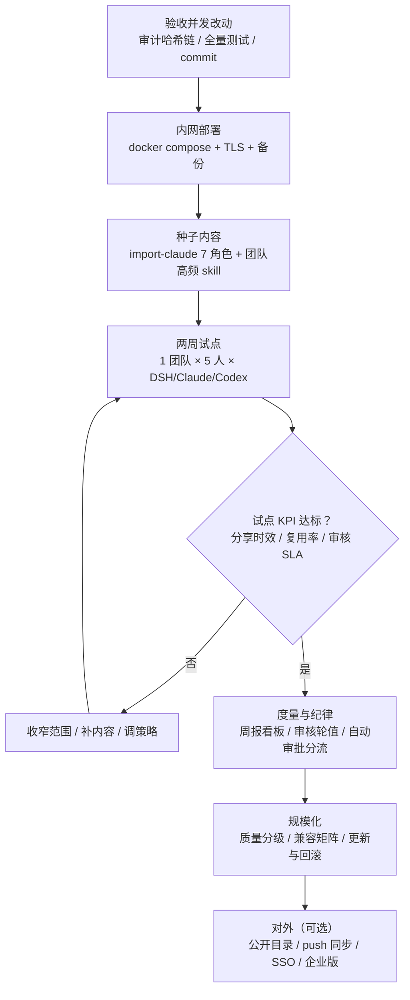
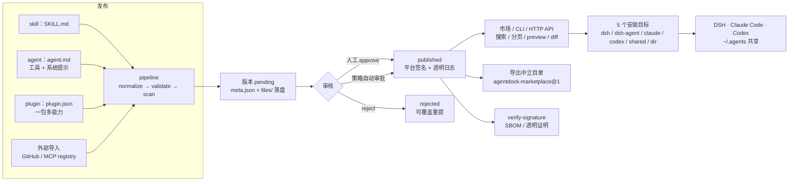
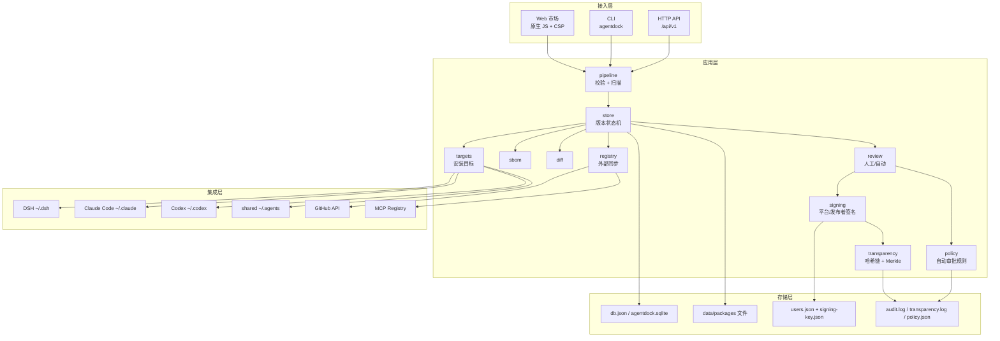
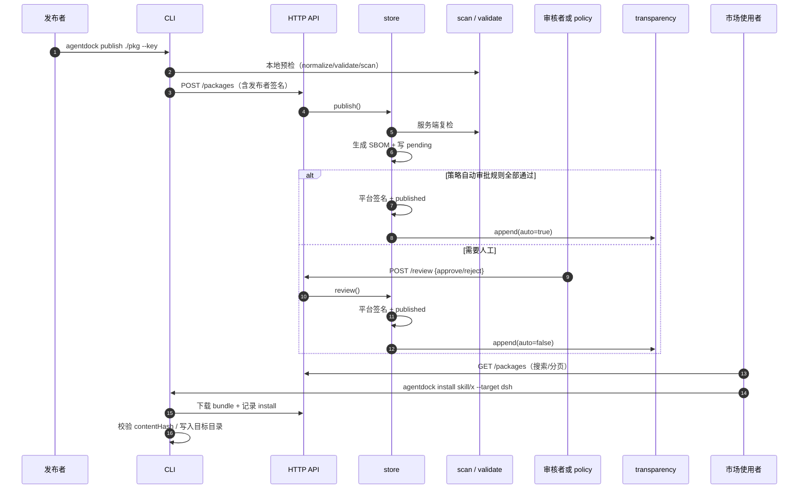
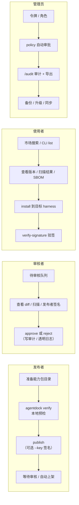
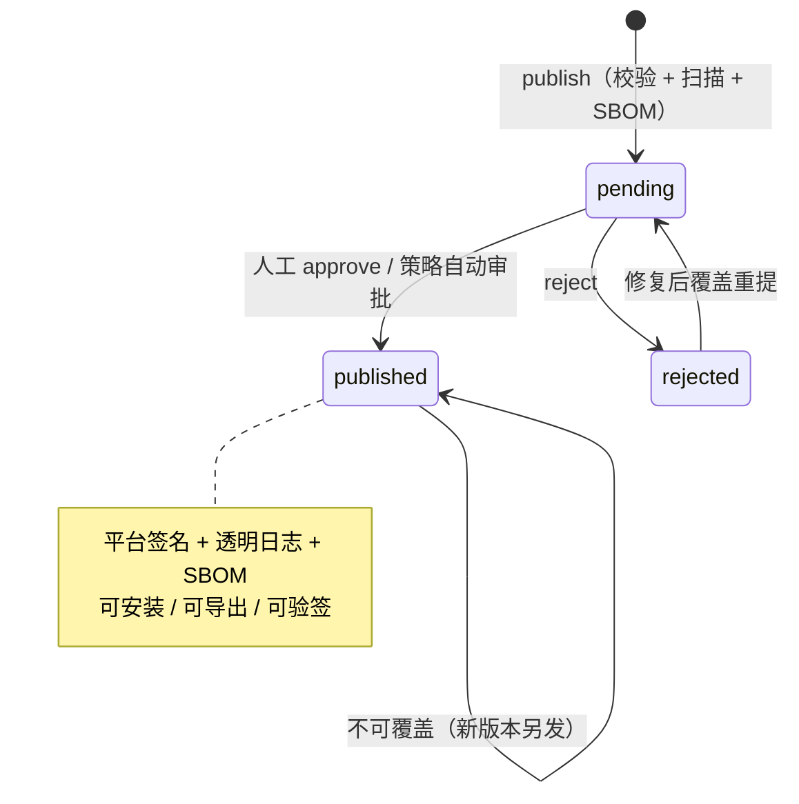
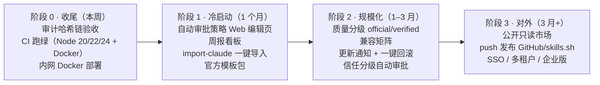

# AgentDock 全景流程图

> 产品现状 · 架构 · 你要走的流程 · 后续对用户可用的功能
> 配套一页图：[flow-overview.png](flow-overview.png)（1800×1320）


- 定位：跨 harness 的 AI 能力（skill / agent / plugin）注册与治理平台
- 现状：v0.1.0，Roadmap ①–④ 全部完成（发布者签名、透明日志、外部同步、SBOM + 自动审批、SQLite 后端），87 个测试通过，JSON / SQLite 两种后端 smoke 均 OK
- 仓库：`agentdock/`（零第三方依赖，Node ≥ 20.11；`node:sqlite` 后端需 Node 24+）

---

## 1. 你要走的整个流程

从「代码交付」到「团队可用」再到「规模化运营」的执行路线。



| 步骤 | 关键动作 | 产出 / 验收 | 用到的能力 |
|---|---|---|---|
| 0 收尾 | 验收并发审计改动、跑测试、补文档、commit | git 干净、`node --test` 全绿 | `/audit`、审计导出 |
| 1 部署 | `docker compose up -d`、反向代理 + TLS、备份 `data/` | 内网地址可访问、令牌交接 | Docker、`/api/v1/health` |
| 2 种子内容 | `import-claude` 导入 7 个角色、发布团队高频 skill | 首批 official 包 ≥ 10 个 | `import-claude`、`publish` |
| 3 试点 | 1 个团队、2 周、三种 harness 全量安装 | KPI 报告 + 5 个可演示故事 | install targets、scan、verify |
| 4 度量与纪律 | 周报、审核轮值、自动审批分流 | 审核 SLA < 4h、签名覆盖率 100% | `/stats`、`/audit`、policy |
| 5 规模化 | 质量分级、兼容矩阵、更新通知/回滚 | 月活发布者/安装者增长 | 版本不可变、透明日志 |
| 6 对外 | 只读目录导出、push 发布、SSO | 对外目录/企业版试点 | `/registry/export` |

---

## 2. 现在做的产品（端到端能力）



| 层 | 已实现能力 |
|---|---|
| 能力格式 | `skill`（SKILL.md）、`agent`（agent.md：tools/model/skills/mcp + 系统提示）、`plugin`（plugin.json 一包多能力） |
| 治理 | 结构校验、路径消毒、体积限制、安全扫描（注入/外泄/密钥/危险命令/隐藏指令）、高危阻断、人工审核、策略自动审批、版本不可变 |
| 信任 | 平台 ed25519 签名、发布者 ed25519 签名（TOFU 公钥注册）、内容哈希重算防篡改、透明日志哈希链 + Merkle 包含证明、SBOM（`agentdock-sbom@1`） |
| 分发 | Web 市场（登录/搜索/分页/文件预览/diff 视图/安装）、CLI 15+ 命令、HTTP API 30+ 路由、5 个安装目标、Claude agent 单文件还原 |
| 同步 | GitHub / MCP registry pull 导入（dry-run + 统一安检）、中立市场目录导出、外部 base URL 服务端白名单防 SSRF |
| 存储 | 零依赖：内容按版本落盘、元数据 `db.json` 或 `node:sqlite`（WAL、增量写、自动迁移）、审计 JSONL、透明日志 append-only |

---

## 3. 架构



模块职责见 [ARCHITECTURE.md](ARCHITECTURE.md)。数据目录：

```
data/
├── db.json | agentdock.sqlite   # 元数据（二选一，AGENTDOCK_STORE）
├── users.json                   # 用户 / 令牌哈希 / 发布者公钥
├── signing-key.json             # 平台签名私钥（600，务必备份）
├── policy.json                  # 自动审批策略（缺省=关闭）
├── audit.log                    # 运维审计（JSONL）
├── transparency.log             # 发布透明日志（哈希链）
└── packages/<kind>/<name>/<version>/
    ├── meta.json / sbom.json
    └── files/                   # 能力包原始内容
```

---

## 4. 一个版本从发布到安装（时序）



---

## 5. 四类用户旅程



---

## 6. 版本状态机



---

## 7. 后续对用户可用的功能（路线图）



| 阶段 | 对用户的新能力 | 依赖现状 | 验收 |
|---|---|---|---|
| 0 | 审计日志哈希链 + 校验/导出接口、CI/Docker 交付 | 已有审计日志，改动待验收 | 测试全绿、镜像可启动 |
| 1 | 浏览器里编辑自动审批策略、周报看板、一键导入 Claude agents | policy API、`/stats`、`/audit` 已有 | 试点团队零 CLI 操作完成上架/安装 |
| 2 | 质量标签、兼容矩阵、更新通知与回滚、信任分级审批 | 版本不可变、签名、透明日志已有 | 包数量/安装量增长、审核吞吐不下降 |
| 3 | 对外只读目录、反向发布、企业身份集成 | `/registry/export`、签名、policy 已有 | 外部可见的可信包目录 + 企业试点 |

---

## 8. 运营度量（周节奏）

| 指标 | 定义 | 目标（试点期） |
|---|---|---|
| 分享时效 | 从提交到可安装的中位耗时 | < 10 分钟（自动审批）/ < 4 小时（人工） |
| 复用率 | 被 ≥2 人安装的包占比 / Top10 周安装 | 逐月上升 |
| 治理 | 高危拦截数、签名覆盖率、pending 超时数 | 签名 100%，超时 0 |
| 覆盖 | 3 种 harness 安装成功率 | > 99% |
| 活跃 | 周发布者 / 周安装者 | 试点团队全员 |

周节奏：清审核队列 → 看 `/stats` 与 Top 包 → 抽检 1 个包 → 更新推荐位 → 生成周报。
